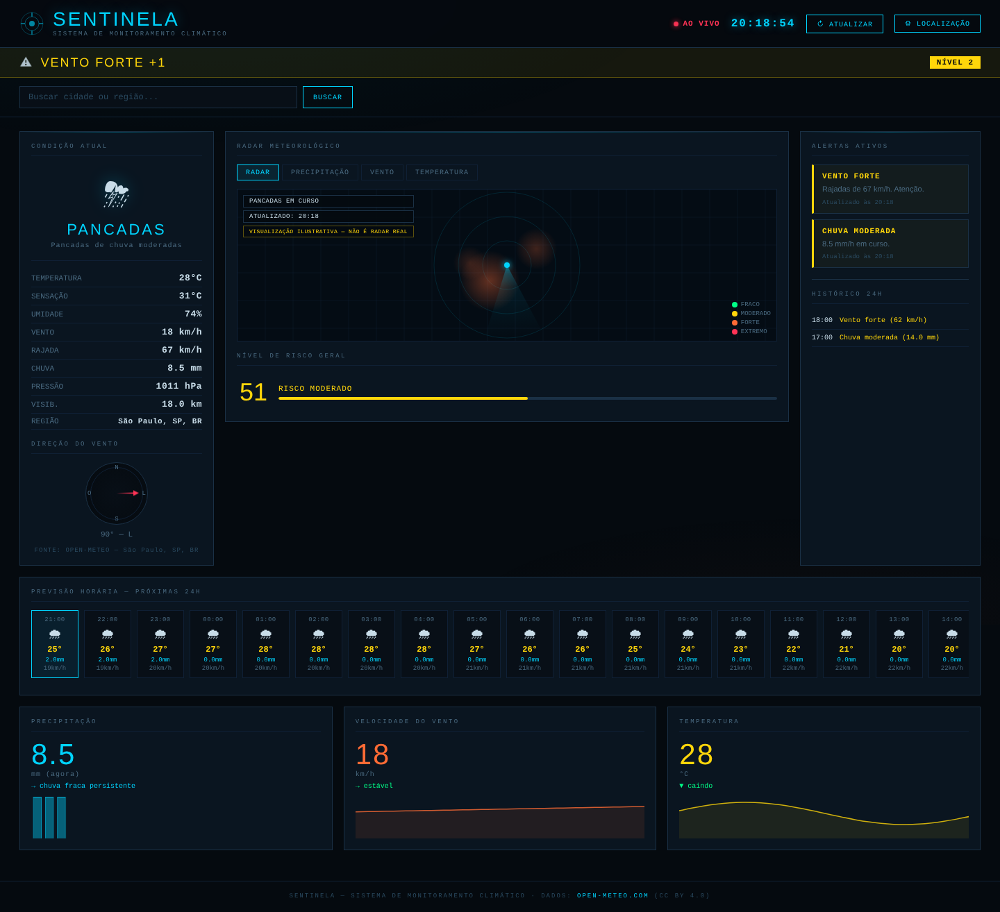

# SENTINELA — Sistema de Monitoramento Climático

Painel web de monitoramento climático em tempo real para qualquer cidade: condições atuais, alertas automáticos, nível de risco, previsão das próximas 24 h e histórico das últimas 24 h.

https://github.com/muhhhzao/Sentinelafr.git



##Funcionalidades

| Recurso | Descrição |
|---|---|
| **Condição atual** | Temperatura, sensação, umidade, vento, rajada, chuva, pressão, visibilidade e bússola do vento |
| **Alertas automáticos** | Rajadas, chuva, tempestade, calor, frio e neblina, ordenados por gravidade, com banner (nível 2 amarelo / nível 3 vermelho) |
| **Nível de risco (0–100)** | Combina chuva, rajadas e tipo de tempo |
| **Previsão horária** | Próximas 24 h + 3 mini-gráficos (chuva, vento, temperatura) com tooltip |
| **Histórico 24 h** | Eventos reais ocorridos nas últimas 24 h (chuva forte, rajadas, tempestade, calor/frio) |
| **Busca de cidades** | Lista de opções quando o nome é ambíguo (ex.: várias "Santa Cruz"), coordenadas manuais ou "usar minha localização" |
| **Resiliente** | Tenta de novo quando a API falha, usa o último dado salvo e, na abertura, cai na demonstração — a tela nunca fica vazia |
| **Modo demonstração** | Cenário de pancadas com rajadas fortes, funciona sem internet |
## Tecnologias

- HTML5, CSS3 e JavaScript (módulos ES) — **sem framework e sem build**
- [Open-Meteo](https://open-meteo.com/) — previsão e geocodificação (gratuita, sem chave)
- [Chart.js 4.6.1](https://www.chartjs.org/) — versionado em `vendor/`, funciona sem CDN
- Node.js ≥ 18 apenas para testes e servidor local (**zero dependências**)

## Como rodar

O projeto usa módulos ES, então precisa ser servido por HTTP (abrir o `index.html` com duplo clique **não** funciona).

```bash
git clone https://github.com/muhhhzao/sentinela-campus-liberdade.git
cd sentinela-campus-liberdade
npm start            # abre em http://localhost:5173
```

Sem Node? Qualquer servidor estático serve: `python3 -m http.server 5173` ou a extensão *Live Server* do VS Code.

```bash
npm test             # 37 testes automatizados (lógica + camada de API)
```

##  Estrutura

```
├── index.html              # página única
├── assets/
│   ├── css/                # base · header · modal · dashboard · layout
│   └── favicon.svg
├── src/js/
│   ├── main.js             # ponto de entrada (só liga os módulos)
│   ├── config.js           # constantes e limiares de alerta
│   ├── state.js            # estado global com publish/subscribe
│   ├── api/                # http (timeout/retry) · openMeteo · geocoding
│   ├── core/               # regras puras, sem DOM: risco, alertas, histórico, vento, WMO...
│   ├── services/           # monitor (atualização/cache/fallback) · storage
│   ├── data/demo.js        # dados de demonstração
│   └── ui/                 # um módulo por painel + radar em canvas
├── tests/                  # node:test
├── vendor/                 # Chart.js
├── scripts/serve.mjs       # servidor local sem dependências
├── docs/                   # arquitetura, sprint final, roteiro de apresentação
└── .github/workflows/      # testes + deploy automático no GitHub Pages
```

Detalhes e decisões em [`docs/ARQUITETURA.md`](docs/ARQUITETURA.md).

##Equipe

Murillo Mello Rodrigues |

Diego Ramos  |

Giulia Rodrigues Daniel  |

João Bovolon Shimada |

Kethelyn Carolyne  |

